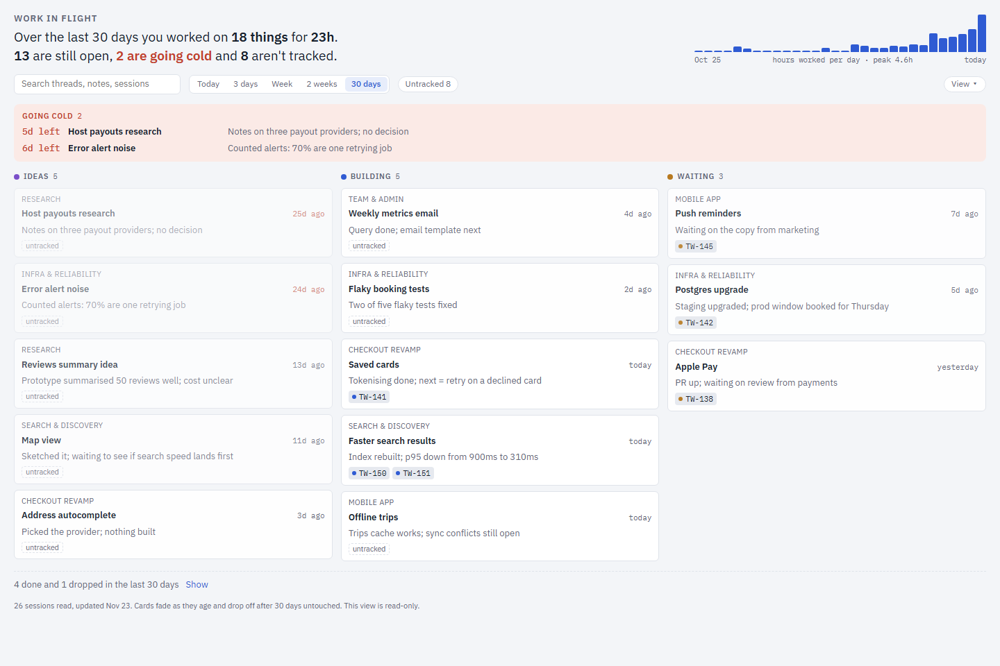

# Work in Flight

A board of everything you've been working on with Claude Code, built from your own sessions.

With Claude you can run ten sessions across three repos and chase a dozen ideas in a week. Most of that is fine to forget. Some of it isn't, and it gets lost in the clutter: the idea you'd half-explored, the fix waiting on a review, the feature that was never ticketed. Work in Flight reads your recent sessions, sorts them into threads, and keeps them on one private board, so you can see where you're at and let the rest go.



*Made-up demo data.*

## What it shows

- **Where your time went.** One sentence up top says what you worked on and for how long ("This week you worked on 9 things for 14.2h"), with a bar chart of hours worked per day. Hours are active time: gaps of more than five minutes don't count.
- **What's still open.** Ideas, Building and Waiting fill the board. Finished and dropped work folds into one line at the bottom.
- **What's going cold.** Anything you haven't worked on in a while fades, and a "Going cold" band lists what's about to drop off the 30-day window. Pick it back up or let it go.
- **What's linked.** Claude groups related threads into families ("Checkout revamp") and shows the family on each card. Group the board by family from the View menu.
- **What's tracked.** If you use an issue tracker, each card shows its tickets and moves with them: a card is only as far along as its least-advanced ticket. Open work with no ticket gets an "untracked" tag.

## Install

In Claude Code:

```
/plugin marketplace add jme900/work-in-flight
/plugin install work-in-flight@work-in-flight
```

Then run `/work-in-flight`. The first run asks four questions: which sessions count, which tracker you use, how new tickets should be written, and how many days to keep. It then sorts your sessions and publishes your board as a private artifact on claude.ai. Run it again whenever you want the board brought up to date.

## Using the board

Click a card to open it: a short summary of the thread, its tickets, hours, sessions, and its controls.

| To | Do |
|---|---|
| Move a card | Drag it to another column, or use its status menu |
| Merge two threads | Drag one onto the other and hold until it says "Release to merge" |
| Change the note | Click the pen next to it |
| Remove a card | Trash icon, top right. Removed cards stay under View → Removed cards |
| Link a ticket | `+` beside the tickets, then paste ids or links |
| Get a new ticket written | `+`, then Create new. Claude reads every session in the thread and writes it |
| Unlink a ticket | `×` on the ticket |
| Narrow the time range | Today, 3 days, Week, 2 weeks or 30 days |
| Undo | Every change shows a toast with Undo |

Your changes stick. A card you move stays put until you work on that thread again or its tickets change. Merges and ticket links stay until you undo them.

**Keep a session open** and run `/work-in-flight` in it once a day. That session then handles Create new within a minute. With no session open, the request waits for your next run.

## Trackers

Claude does all tracker work through the connector or CLI you already have.

| Tracker | Needs | Status |
|---|---|---|
| Linear | Linear connector | Tested |
| GitHub Issues | `gh` CLI | Tested |
| Jira | Atlassian connector | Best effort, not yet run against a real site |
| Asana | Asana connector | Best effort, not yet run against a real workspace |
| None | Nothing | Tested. Ticket controls are hidden |

Each tracker's details are in [`skills/work-in-flight/trackers/`](skills/work-in-flight/trackers/). Reports from Jira and Asana users are welcome.

## What it reads and where it goes

- It reads Claude Code's session transcripts in `~/.claude/projects/` on your machine. They hold your prompts and Claude's tool calls.
- Claude labels new sessions in your own Claude Code session, the same way it works on anything else you ask.
- Your settings and labels stay in `~/.claude/work-in-flight/`.
- The board is a private artifact in your claude.ai account. It holds thread names, notes, summaries and session titles, not your code.

## Requirements and limits

- Claude Code signed in with a claude.ai account, which publishing artifacts needs. API-key-only setups can't publish the board.
- Python 3.9 or newer, standard library only.
- Claude Code deletes transcripts after 30 days by default (`cleanupPeriodDays`), so the board can't look back further than that unless you raise it.
- The transcript format isn't documented and could change in a Claude Code release. All the parsing lives in one function, `scan()` in `worklog.py`, so a fix is small.

## Files

```
skills/work-in-flight/
  SKILL.md        what Claude does on each run
  worklog.py      reads sessions, keeps labels, builds the board
  board.html      the board page
  trackers/       linear.md, github.md, jira.md, asana.md
demo/make_demo.py builds the demo board from made-up sessions
```

## License

MIT
